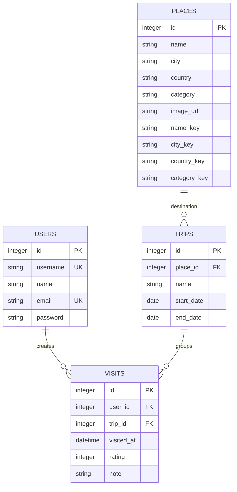

# Отчет по практической работе 4

## Общие сведения

Дисциплина: Технологии разработки приложений на базе фреймворков

Тема индивидуального проекта: Система учета посещенных мест

Рабочее название: Visited Places

Группа: ЭФБО-14-24

ФИО студента: Логвинов Глеб Дмитриевич

Формат выполнения: индивидуально. Работа выполнена самостоятельно.

Год выполнения: 2026

## Цель работы

Цель ПР4 - спроектировать и реализовать базу данных для монолитного
веб-приложения: определить сущности, атрибуты, связи, ключи, типы данных,
ограничения, индексы и способы обеспечения целостности и безопасности.
Дополнительно рассматриваются нормализация, денормализация, кеширование
и агрегирование данных.

В ПР1-3 была подготовлена консольная версия с SQLite-хранилищем.
На данном этапе предметная область перенесена в Django ORM. Веб-приложение
использует отдельную базу `data/web.sqlite3`; ее схема описана моделями
`visited_places/models.py` и миграцией
`visited_places/migrations/0001_initial.py`.

## Анализ требований

Для учета посещенных мест необходимо хранить:

- учетные записи пользователей и сведения для входа;
- общий каталог мест с городом, страной и категорией;
- общие поездки к конкретному месту с датами начала и окончания;
- личные отметки о посещениях с датой, оценкой и заметкой.

Связи предметной области сохранены: пользователь относится к отметке,
место относится к поездке. У `Trip` нет поля `user`, у `Visit` нет поля
`place`; место посещения определяется через `visit.trip.place`.

Основные требования к данным:

| Требование | Принятое решение |
| --- | --- |
| Пользователь имеет собственную историю | Отметка содержит обязательный `user_id`, API выбирает владельца из сессии |
| Каталог мест и поездок общий | У поездки нет владельца; изменение общего каталога ограничено правами администратора |
| Отметка всегда относится к поездке | `trip_id` является обязательным внешним ключом |
| Повторная регистрация с тем же email запрещена | Email нормализуется и имеет ограничение `UNIQUE` |
| Дубли мест не должны искажать статистику | Уникальна комбинация нормализованных названия, города и страны |
| Даты и оценки должны быть корректными | Используются типизированные поля, проверки моделей и ограничения `CHECK` |
| Удаление не должно оставлять потерянные связи | Используются внешние ключи и правила удаления Django ORM |
| История должна сохраняться между запусками | Записи хранятся в постоянной SQLite-базе |

## Выбор технологии

Для учебного монолитного приложения выбраны SQLite и Django ORM.
SQLite не требует отдельного сервера БД, а Django предоставляет модели,
миграции, формы, транзакции и стандартную систему пользователей.

Настройки подключения находятся в `config/settings.py`:

- стандартный путь к базе: `data/web.sqlite3`;
- альтернативный путь можно задать через `VISITED_PLACES_DB`;
- время ожидания блокировки SQLite: 20 секунд;
- режим транзакций: `IMMEDIATE`;
- пользовательская модель: `AUTH_USER_MODEL = "visited_places.User"`;
- часовой пояс интерфейса: `Europe/Moscow`, `USE_TZ = True`.

Изменения API выполняются внутри `transaction.atomic()`. Режим `IMMEDIATE`
запрашивает блокировку записи в начале такой транзакции. Это помогает
согласовать проверки и сохранение в небольшом приложении, но не делает
SQLite подходящей для неограниченного количества параллельных записей.

## Сущности и атрибуты

Типы в таблицах соответствуют декларациям действующей веб-базы SQLite.
SQLite использует динамическую типизацию; длину строк и форматы входных
значений дополнительно проверяют формы и модели Django.

### User

Пользователь журнала и учетная запись для входа. Модель наследуется
от `AbstractUser`. Имя для отображения хранится в поле `name`.

Таблица: `visited_places_user`.

| Поле | Поле Django | Тип в SQLite | Назначение и ограничения |
| --- | --- | --- | --- |
| `id` | `BigAutoField` | `INTEGER` | Автоматический первичный ключ |
| `username` | `CharField(150)` | `VARCHAR(150)` | Уникальный логин |
| `name` | `CharField(150)` | `VARCHAR(150)` | Отображаемое имя, обязательное в форме |
| `email` | `EmailField(254)` | `VARCHAR(254)` | Уникальный email, `NOT NULL`, запрет пустой строки через `CHECK` |
| `password` | `CharField(128)` | `VARCHAR(128)` | Хеш пароля, а не открытый пароль |
| `is_active` | `BooleanField` | `BOOL` | Признак активной учетной записи |
| `is_staff` | `BooleanField` | `BOOL` | Признак доступа администратора |
| `is_superuser` | `BooleanField` | `BOOL` | Полные административные права |
| `last_login` | `DateTimeField` | `DATETIME` | Время последнего входа, допускается `NULL` |
| `date_joined` | `DateTimeField` | `DATETIME` | Время регистрации |

Также наследуются стандартные поля `first_name`, `last_name` и связи
с группами и разрешениями Django. Основное имя приложения определяется
полем `name`. При сохранении email очищается от пробелов по краям
и приводится к единому регистру через `casefold()`.

### Place

Объект общего каталога мест.

Таблица: `visited_places_place`.

| Поле | Поле Django | Тип в SQLite | Назначение и ограничения |
| --- | --- | --- | --- |
| `id` | `BigAutoField` | `INTEGER` | Первичный ключ |
| `name` | `CharField(160)` | `VARCHAR(160)` | Название места, обязательное непустое значение в модели |
| `city` | `CharField(100)` | `VARCHAR(100)` | Город, обязательное значение |
| `country` | `CharField(100)` | `VARCHAR(100)` | Страна, обязательное значение |
| `category` | `CharField(60)` | `VARCHAR(60)` | Категория места, обязательное значение |
| `image_url` | `URLField(500)` | `VARCHAR(500)` | Необязательный адрес фотографии, пустая строка разрешена |
| `name_key` | `CharField(480)` | `VARCHAR(480)` | Нормализованное название |
| `city_key` | `CharField(300)` | `VARCHAR(300)` | Нормализованный город |
| `country_key` | `CharField(300)` | `VARCHAR(300)` | Нормализованная страна |
| `category_key` | `CharField(180)` | `VARCHAR(180)` | Нормализованная категория |

Служебные поля `*_key` не редактируются через формы. Они вычисляются
из очищенных исходных строк через `casefold()` при проверке модели.
Комбинация `name_key`, `city_key`, `country_key` уникальна.
Для внешнего адреса фотографии допускаются только схемы HTTP и HTTPS.

### Trip

Общая поездка к одному месту. Разные пользователи могут создавать свои
отметки для одной и той же поездки.

Таблица: `visited_places_trip`.

| Поле | Поле Django | Тип в SQLite | Назначение и ограничения |
| --- | --- | --- | --- |
| `id` | `BigAutoField` | `INTEGER` | Первичный ключ |
| `place_id` | `ForeignKey(Place)` | `BIGINT` | Обязательный внешний ключ на место |
| `name` | `CharField(160)` | `VARCHAR(160)` | Непустое название поездки |
| `start_date` | `DateField` | `DATE` | Дата начала |
| `end_date` | `DateField` | `DATE` | Дата окончания, не раньше начала |

Поля `user` и `user_id` отсутствуют. Дата передается в API в формате
`YYYY-MM-DD`. При изменении периода модель проверяет, что существующие
отметки всех пользователей остаются внутри новых дат.

### Visit

Личная отметка о посещении, связанная с пользователем и поездкой.

Таблица: `visited_places_visit`.

| Поле | Поле Django | Тип в SQLite | Назначение и ограничения |
| --- | --- | --- | --- |
| `id` | `BigAutoField` | `INTEGER` | Первичный ключ |
| `user_id` | `ForeignKey(User)` | `BIGINT` | Обязательный владелец отметки |
| `trip_id` | `ForeignKey(Trip)` | `BIGINT` | Обязательная поездка |
| `visited_at` | `DateTimeField` | `DATETIME` | Дата и время посещения |
| `rating` | `PositiveSmallIntegerField` | `SMALLINT UNSIGNED` | Необязательная оценка, `NULL` или 1-5 |
| `note` | `TextField` | `TEXT` | Заметка, допускается пустая строка, максимум 2000 символов в форме и модели |

Уникальна комбинация `user_id`, `trip_id`, `visited_at`.
Место отдельно не сохраняется. Дата посещения в московском часовом поясе
должна входить в период поездки, включая обе граничные даты.
В API время без смещения трактуется как московское; Django сохраняет
время с учетом `USE_TZ` и возвращает его в локальном представлении.

## Связи и схема данных

Кардинальности основных связей:

- `User -> Visit`: один ко многим;
- `Place -> Trip`: один ко многим;
- `Trip -> Visit`: один ко многим.

Каждая отметка обязательно имеет пользователя и поездку. Каждая поездка
обязательно имеет место. Прямые связи `Trip -> User` и `Visit -> Place`
не используются.



Диаграмма показывает предметную область. В веб-базе дополнительно
создаются стандартные таблицы Django для сессий, групп, разрешений,
типов содержимого, административного журнала и истории миграций.

## Ключи, ограничения и удаление

Первичные ключи всех четырех сущностей - автоматически создаваемые `id`.
Внешние ключи связывают поездку с местом, а отметку - с пользователем
и поездкой.

Именованные ограничения веб-базы:

| Ограничение | Содержание |
| --- | --- |
| `user_email_not_empty` | Email не равен пустой строке |
| `unique_place_location` | Нормализованные название, город и страна не повторяются |
| `trip_dates_in_order` | Начало поездки не позже окончания |
| `unique_user_trip_visit` | Нет двух отметок одного пользователя для одной поездки в один момент времени |
| `visit_rating_range` | Оценка отсутствует или находится в диапазоне 1-5 |

Дополнительно `username` и `email` имеют `UNIQUE`, а обязательные поля
и внешние ключи - `NOT NULL`. Форматы email/URL, длины строк,
непустые названия и целочисленные значения API проверяются на уровне
форм и моделей; не все эти проверки являются SQL-ограничениями SQLite.

Правила удаления Django ORM:

- `Trip.place`: `PROTECT` - место с поездками нельзя удалить;
- `Visit.trip`: `PROTECT` - поездку с отметками нельзя удалить;
- `Visit.user`: `CASCADE` - при удалении пользователя через ORM удаляются
  его отметки, но общий каталог и чужие отметки сохраняются.

`PROTECT` и `CASCADE` здесь являются правилами Django ORM, а не
декларациями SQL `ON DELETE CASCADE` в SQLite. Внешние ключи БД дополнительно
контролируют целостность ссылок. В веб-схеме не используются триггеры
консольной базы из ПР3: межтабличные правила дат реализованы в `clean()`
моделей и выполняются при штатном сохранении.

Ручные SQL-изменения и `QuerySet.update()`, обходящие модельные проверки
и пересчет `*_key`, не являются поддерживаемым способом редактирования
журнала. Они не получают всех гарантий проверок приложения.

## Индексы и оптимизация

В схеме явно определены индексы:

| Индекс | Поля | Назначение |
| --- | --- | --- |
| `place_city_country` | `city_key`, `country_key` | Выборки мест по нормализованному расположению |
| `trip_place_dates` | `place_id`, `start_date`, `end_date` | Поездки к месту и работа с датами |
| `visit_user_date` | `user_id`, `visited_at DESC` | Персональная история в порядке времени |

Django также создает индексы для внешних ключей, а SQLite - индексы
для уникальных ограничений. Наличие индекса не означает, что поиск
произвольной подстроки автоматически становится индексным.

В API применены дополнительные способы оптимизации:

1. `select_related("trip__place")` загружает отметку, поездку и место
   без отдельного SQL-запроса для каждой строки.
2. `select_related("place")` используется для списка поездок.
3. Списки имеют пагинацию: по умолчанию 12 записей, максимум 200 на страницу.
4. Списки упорядочены с дополнительным ключом `id`, чтобы одинаковые даты
   или названия не приводили к неопределенному порядку.
5. Статистика рассчитывается через агрегаты ORM `Count`, `Avg`, `Min`
   и группировку, а не хранится как дублируемые поля каждой записи.
6. Результат статистики кешируется на 60 секунд отдельно для пользователя.

Статистика включает количество отметок, уникальных мест, городов, стран
и поездок, среднюю оценку, посещения по странам и наиболее посещаемые места.
Города различаются по паре город/страна, страны группируются по
нормализованному ключу, а места - по идентификатору. Отсутствующие оценки
не включаются в среднее значение.

Кеш настроен через `LocMemCache`. В `visited_places/signals.py` после
успешного завершения транзакции сбрасывается статистика владельца измененной
отметки. Изменение места или поездки сбрасывает кеш статистики целиком.
Для нескольких процессов потребуется общий кеш, например отдельный
сервер кеширования; он в текущей учебной установке не подключен.

Поиск по названиям поездок и русским заметкам использует Python `casefold()`
после ограничения доступных пользователю записей. Это обеспечивает
корректное сравнение кириллицы, но требует чтения подходящего набора
до пагинации. Для больших объемов нужен другой способ текстового поиска.

## Нормализация и денормализация

Основная предметная модель разделена по сущностям:

1. Значения атомарны: даты, оценка, город, страна и категория имеют
   отдельные поля.
2. Данные пользователя хранятся в его таблице, данные места - в каталоге,
   название и период поездки - в поездке, оценка и заметка - в отметке.
3. В отметке не повторяются название места, его расположение и `place_id`:
   они определяются через поездку.

Для основных предметных данных применены принципы первой нормальной формы
(атомарные значения), второй (зависимость атрибутов от полного ключа)
и третьей (отсутствие дублирования данных других сущностей).
Поля `*_key` являются осознанной служебной денормализацией:
они повторяют текст в нормализованном виде для сравнения Unicode-строк
и обеспечения уникальности. Они вычисляются моделью, а не вводятся
пользователем независимо от исходных значений.

Постоянные счетчики посещений и материализованные таблицы статистики
не добавлены. Для текущего объема достаточно агрегаций и кратковременного
кеша. При дальнейшем росте такие решения допустимы только с механизмом
актуализации, иначе появится рассинхронизация со списком отметок.

## Миграции и перенос данных

Создание веб-базы и проверка соответствия модели выполняются командами:

```powershell
.\venv\Scripts\python.exe manage.py migrate
.\venv\Scripts\python.exe manage.py makemigrations --check --dry-run
.\venv\Scripts\python.exe manage.py import_journal
```

Команда `import_journal` открывает `data/journal.sqlite3` только для чтения.
Она переносит пользователей, места, поездки и отметки в новую веб-базу
одной транзакцией. Если консольной базы нет, используется исходный JSON-набор.
Старые записи версии 1 при необходимости преобразуются в памяти.

Повторный импорт пропускается, если веб-журнал уже содержит места, поездки
или отметки; сохраненные веб-данные не заменяются исходным набором.
Пароли импортированным пользователям не придумываются: первоначально
им назначается недоступный для входа пароль. Подготовка локального
учебного аккаунта выполняется отдельно через `setup_demo`.

Консольная база остается отдельным хранилищем. Автоматической синхронизации
между `journal.sqlite3` и `web.sqlite3` нет. При проверке переноса
подтверждены сохранение предметных записей и неизменность исходной базы.

## Безопасность данных

Реализованные меры:

- пароли хранятся как хеши средствами Django, открытый пароль не записывается
  в модель пользователя;
- API личных отметок фильтруется по `request.user`, передача чужого `user_id`
  через форму не разрешена;
- изменять и удалять общие места и поездки может только пользователь
  с `is_staff`;
- изменяющие запросы требуют CSRF-токен и проверку входных данных;
- обращения к предметным таблицам выполняются через Django ORM;
- транзакции, внешние ключи и ограничения защищают согласованность записей.

Разграничение доступа реализовано на уровне приложения. SQLite не имеет
отдельных учетных записей и ролей для этого файла базы, поэтому пользователь
ОС с доступом к файлу может обойти ограничения веб-интерфейса.
Файловые права и защита резервных копий относятся к настройке ОС.

Хеширование пароля не является шифрованием всей базы. Шифрование SQLite
и автоматическое резервное копирование не реализованы. Для чувствительных
данных необходимо дополнительно ограничивать доступ к файлам, использовать
шифрование диска и резервных копий, а для сетевого размещения - HTTPS.
Копию `data/web.sqlite3` в учебной установке следует делать при остановленном
сервере.

В production-настройках предусмотрены отдельный секрет, отключение DEBUG,
Secure cookies, перенаправление на HTTPS и HSTS. Это настройки готовности
к размещению, а не подтверждение настроенного HTTPS: локальная демонстрация
работает на HTTP-адресе `127.0.0.1`.

## Проверка реализации

Проверки моделей и API находятся в `visited_places/webtests/test_web.py`.
Они охватывают связи сущностей, дубли, даты, оценки, защищенное удаление,
правила доступа, агрегирование, кеш и импорт.

В частности, проверены:

- отсутствие `Trip.user` и `Visit.place`;
- отклонение дубля места при разном регистре русских букв;
- проверки дат и оценки в модели и ограничения в БД;
- запрет изменения периода поездки с конфликтующими отметками;
- удаление пользователя без удаления общего каталога и чужой истории;
- отсутствие дополнительных запросов на каждую строку списка;
- объединение стран с разным регистром и раздельный учет одноименных мест;
- отсутствие запроса к таблице отметок при повторном чтении кешированной
  статистики;
- повторный импорт без изменения источника и без дублирования записей.

Контрольная проверка на этапе ПР4-ПР5: 40 веб-тестов пройдены.
После дополнения шаблонов в ПР6 набор расширен до 66 веб-тестов;
новые проверки описаны в `REPORT_PR6.md`.
`manage.py check` не сообщает проблем, а
`makemigrations --check --dry-run` возвращает `No changes detected`.
Отдельная регрессионная проверка консольной части: `167 passed`.

## Соответствие заданию

| Шаг ПР4 | Результат |
| --- | --- |
| Основы проектирования БД | Описаны сущности, атрибуты, ключи и отношения |
| Анализ требований | Определены личные отметки, общие места/поездки и правила согласованности |
| Проектирование схемы | Созданы модели Django, миграция, таблицы, ограничения и индексы |
| Оптимизация | Применены связанные выборки, пагинация, агрегации и кеш статистики |
| Нормализация и денормализация | Разделены предметные данные, обоснованы служебные нормализованные ключи |
| Безопасность | Реализованы хеширование паролей и ограничения API; явно обозначены требования к HTTPS и защите файлов БД |

## Вывод

В ПР4 спроектирована и реализована база данных монолитного веб-приложения
Visited Places. Подготовлены модели и миграции Django, определены типы
полей, ключи, ограничения, индексы и правила удаления. Реализован перенос
данных из консольной версии без изменения источника.

Для оптимизации используются связанные запросы, агрегации, пагинация
и кеширование статистики. Основная модель нормализована; служебная
избыточность текстовых ключей обоснована особенностями сравнения кириллицы.
Разграничение доступа и хеширование паролей реализованы в веб-приложении,
а шифрование файла базы и внешнее HTTPS-размещение остаются отдельными
задачами настройки.
