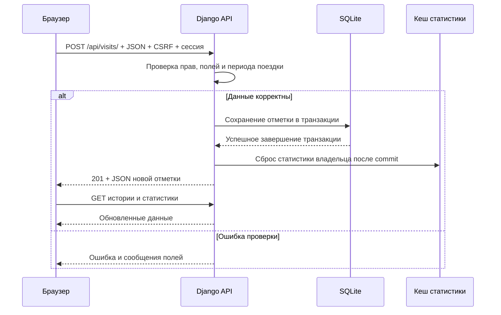

# Отчет по практической работе 5

## Общие сведения

Дисциплина: Технологии разработки приложений на базе фреймворков

Тема индивидуального проекта: Система учета посещенных мест

Рабочее название: Visited Places

Группа: ЭФБО-14-24

ФИО студента: Логвинов Глеб Дмитриевич

Формат выполнения: индивидуально. Работа выполнена самостоятельно.

Год выполнения: 2026

## Цель работы

Цель ПР5 - реализовать серверную и клиентскую части веб-приложения,
связать их через API, обеспечить аутентификацию, авторизацию, проверку
входных данных и оптимизацию, выполнить тестирование и локальное
развертывание.

Результат работы - монолитное приложение Visited Places, которое
позволяет в браузере вести личный журнал посещений, работать с общими
местами и поездками, изменять оценки и заметки и просматривать статистику.
В отличие от консольного выбора профиля, веб-версия подтверждает личность
пользователя через вход и сессию.

## Выбранный стек

| Компонент | Технология | Назначение |
| --- | --- | --- |
| Язык серверной части | Python | Серверная логика и команды управления |
| Веб-фреймворк | Django 5.2.18 | Маршруты, шаблоны, формы, ORM, аутентификация и сессии |
| База данных | SQLite | Постоянное хранение предметных данных |
| Интерфейс | HTML, CSS, JavaScript | Страницы, формы, таблицы, фильтры и пользовательские действия |
| Интеграция | JSON API и `fetch` | Обмен данными браузера с сервером |
| WSGI-сервер | Waitress 3.0.2 | Запуск приложения в Windows без Django runserver |
| Статические файлы | WhiteNoise 6.12.0 | Выдача собранных CSS, JavaScript, иконок и фотографий |
| Иконки | Локальный Lucide | Элементы навигации и кнопки действий |
| Проверки | Django TestCase, pytest 8.3.3, flake8 7.1.1 | Веб-тесты, регрессия консольной части и проверка стиля |

React, отдельный frontend-сервер, микросервисы и внешняя серверная СУБД
не используются. Интерфейс и API принадлежат одному Django-проекту
и работают на одном адресе.

## Структура монолита

```text
manage.py                         команды Django
serve.py                          запуск Waitress
config/
  settings.py                     настройки БД, сессий, кеша и безопасности
  urls.py                         основные маршруты и Django admin
  wsgi.py                         WSGI-приложение
  asgi.py                         стандартная точка входа ASGI
visited_places/
  models.py                       модели и предметные проверки
  forms.py                        проверка данных форм и API
  api.py                          JSON-обработчики
  views.py                        страницы, регистрация, вход и выход
  urls.py                         маршруты приложения
  admin.py                        административные представления
  signals.py                      сброс кеша после изменений
  migrations/                     миграции веб-базы
  management/commands/            импорт, учебный аккаунт, нагрузочная проверка
  templates/visited_places/       HTML-шаблоны
  static/visited_places/          CSS, JavaScript, фотографии, иконки
  webtests/test_web.py            автоматические веб-тесты
data/web.sqlite3                  веб-база
staticfiles/                      собранные ресурсы для WSGI-сервера
API.md                            описание API и модели данных
README.md                         установка, запуск и ограничения
```

Консольные модули, `main.py`, база `data/journal.sqlite3` и тесты предыдущих
практических сохранены. Это отдельная версия приложения, а не второй
сервер веб-части. Пустой дублирующий проект `acme_project` удален после
сохранения резервной копии вне рабочего проекта.

## Серверная логика

Сервер использует модели `User`, `Place`, `Trip`, `Visit` из ПР4.
Предметные правила находятся в моделях и формах; маршруты API выполняют
проверку сессии и прав, выбирают доступные записи и возвращают JSON.
Операции записи выполняются в транзакциях.

Основные бизнес-правила:

| Правило | Реализация |
| --- | --- |
| Пользователь подтверждает личность | Регистрация, LoginView и сессия Django |
| Места и поездки общие | Доступны для чтения и создания всем вошедшим пользователям |
| Общие записи нельзя произвольно изменять | PATCH/DELETE мест и поездок требуют `is_staff` |
| Отметки являются личными | Выборка ограничена `user=request.user` |
| Нельзя назначить чужого владельца | `user` отсутствует в форме API и определяется сервером |
| Поездка всегда относится к месту | Обязательный `Trip.place` |
| Посещение всегда относится к поездке | Обязательный `Visit.trip`; прямого `Visit.place` нет |
| Даты согласованы | Начало поездки не позже окончания, дата посещения входит в период |
| Существующая история сохраняет корректность | Новые даты поездки не должны исключать сохраненные отметки |
| Оценки и заметки ограничены | Оценка 1-5 или отсутствует; заметка до 2000 символов |
| Дубли запрещены | Проверки модели и уникальные ограничения БД |
| Используемые объекты нельзя удалить | `PROTECT` для места с поездками и поездки с отметками |

Формы `PlaceForm`, `TripForm`, `VisitForm`, `ProfileForm` определяют
разрешенные поля. Неизвестные поля и неверные JSON-типы отклоняются.
Частичное изменение через PATCH сохраняет поля, отсутствующие в запросе.
Ошибка проверки не должна применять некорректное изменение записи.

Административный интерфейс Django предоставлен отдельно для пользователей
с соответствующими правами. В обычном API даже администратор получает
только собственные отметки; административное управление чужими записями
относится к отдельному интерфейсу и его разрешениям.

## API

Реализован JSON API с ресурсами и HTTP-методами GET, POST, PATCH, DELETE.
GraphQL не используется. Полное описание адресов, полей, прав, фильтров
и ответов находится в [API.md](API.md).

| Адрес | Методы | Назначение |
| --- | --- | --- |
| `/api/me/` | GET, PATCH | Чтение и изменение собственного имени/email |
| `/api/places/` | GET, POST | Список мест и создание места |
| `/api/places/{id}/` | GET, PATCH, DELETE | Чтение, изменение и удаление места |
| `/api/trips/` | GET, POST | Список поездок и создание поездки |
| `/api/trips/{id}/` | GET, PATCH, DELETE | Чтение, изменение и удаление поездки |
| `/api/visits/` | GET, POST | Своя история и создание отметки |
| `/api/visits/{id}/` | GET, PATCH, DELETE | Чтение, изменение и удаление своей отметки |
| `/api/statistics/` | GET | Персональная статистика |

Запросы записи передают JSON с `Content-Type: application/json`, cookie
сессии и заголовком `X-CSRFToken`. GET-запросы предназначены для чтения.
Списки принимают `page`, `page_size`, `q`; история дополнительно
поддерживает `trip`, `from`, `to`.

Пример создания отметки для существующей поездки с подходящими датами:

```json
{
  "trip": 1,
  "visited_at": "2026-06-11T12:00",
  "rating": 5,
  "note": "Повторная прогулка"
}
```

В теле нет пользователя и места. Владелец определяется из сессии,
а место - из выбранной поездки. Ответ содержит созданную отметку
с вложенной поездкой и местом; при успехе возвращается код 201.

Формат ответа списка:

```json
{
  "results": [],
  "count": 0,
  "page": 1,
  "pages": 1
}
```

Коды ответов: 200 - успешное чтение/изменение/удаление, 201 - создание,
400 - некорректные поля или параметры, 401 - отсутствие входа при обработке
API, 403 - недостаточные права или ошибка CSRF, 404 - отсутствующая
или чужая отметка, 405 - неподдерживаемый метод, 409 - конфликт записи
или защищенное удаление.

Ошибка возвращается в виде `{"error": "Сообщение", "errors": {...}}`.
Поле `errors` с сообщениями по отдельным полям может отсутствовать.
Для чужих отметок используется 404, чтобы обычный интерфейс не выдавал
их содержимое или сведения о доступности записи.

## Пользовательский интерфейс

Основные страницы:

| Страница | Адрес | Элементы интерфейса |
| --- | --- | --- |
| Вход | `/login/` | Логин, пароль, сообщения ошибок |
| Регистрация | `/register/` | Логин, имя, email, пароль и подтверждение |
| Мой журнал | `/` | История, оценки, заметки, поиск, фильтры, добавление и изменение |
| Места | `/places/` | Каталог с фотографиями, городом, страной, категорией и действиями |
| Поездки | `/trips/` | Место, даты поездки, счетчик отметок и доступные действия |
| Статистика | `/statistics/` | Итоги, посещения по странам и наиболее посещаемые места |
| Администрирование | `/admin/` | Стандартные формы управления данными Django |

Из основной навигации доступно окно профиля с редактированием имени/email.
Выход выполняется отдельной POST-формой. Для создания и изменения записей
используются диалоговые формы; удаление требует подтверждения.

В форме поездки выбирается место, а в форме отметки - поездка. Поля
пользователя в поездке и самостоятельного места в отметке отсутствуют.
Оценка выбирается из списка 1-5 или оставляется пустой. Допустимый диапазон
даты посещения связывается с датами выбранной поездки.

Интерфейс имеет адаптивную компоновку: на широком экране используется
боковая навигация и таблицы, на небольшом - нижняя навигация и компактные
представления записей. Предусмотрены состояния загрузки, пустого списка,
ошибки, недоступной фотографии и завершения действия.
Иконки Lucide и фотографии учебного набора хранятся локально;
источники и лицензии фотографий указаны в
`visited_places/static/visited_places/images/credits.json`.

## Клиентская логика и интеграция

Клиентский код находится в `visited_places/static/visited_places/app.js`.
В том же каталоге расположены `base.js` для общей инициализации иконок
и `app.css` для оформления.
Для обращения к API используется `fetch` с `credentials: "same-origin"`.
CSRF-токен берется из метаданных HTML-страницы.

Обработка сохранения состоит из следующих действий:

1. Пользователь заполняет диалоговую форму.
2. Браузер проверяет обязательные поля и допустимые значения элементов.
3. JavaScript собирает объект JSON и преобразует ID/оценку в числа.
4. Сервер проверяет сессию, CSRF, права и предметные ограничения.
5. После успешной записи браузер обновляет список, варианты выбора
   и персональную статистику.
6. При ошибке форма остается доступной, сообщения выводятся рядом
   с полями или в общем блоке ошибки.



Поиск запускается с задержкой 250 мс после ввода. Номер запроса помогает
не показывать устаревший результат, если ответы пришли в другом порядке.
Фильтры и пагинация обновляют данные без полной перезагрузки страницы.
Кнопка сохранения блокируется на время запроса, чтобы уменьшить риск
повторной отправки. При ответе 401 браузер переходит на страницу входа.

Данные пользователей, включая заметки, выводятся через `textContent`,
а не вставляются как произвольный HTML. Клиентские проверки улучшают
удобство, но не заменяют обязательную проверку данных на сервере.

## Аутентификация, авторизация и безопасность

Регистрация реализована на основе `UserCreationForm`, вход - через
`LoginView`, выход - через `LogoutView`. Пароли проверяются и хешируются
штатными средствами Django. После успешного входа используется сессия,
а страницы журнала требуют `login_required`.

Реализованные меры защиты:

- выборка личных отметок только по подтвержденному пользователю;
- проверка `is_staff` при изменении общего каталога;
- запрет назначения владельца и изменения привилегий через JSON;
- CSRF-защита форм и изменяющих API-запросов;
- проверка типов JSON, форматов дат, диапазонов и длины строк;
- параметризованные обращения к данным через ORM;
- безопасное текстовое отображение заметок;
- cookies с `HttpOnly` и `SameSite=Lax`;
- ограничение попыток входа: после 10 ошибок для пары IP/логин
  последующие попытки блокируются до истечения пятиминутного окна;
- запрет стороннего адреса при перенаправлении после входа;
- защита от встраивания страницы через `X-Frame-Options: DENY`;
- проверка HTTP/HTTPS-схемы адреса фотографии.

Лимит попыток хранится в локальном кеше процесса. Для внешнего сервиса
с несколькими процессами потребуется централизованное ограничение.
Внешние фотографии загружает браузер; сервер не выполняет скачивание
произвольного пользовательского URL.

При `DJANGO_DEBUG=0` настройки включают Secure cookies, перенаправление
на HTTPS и HSTS, а секрет должен быть передан через `DJANGO_SECRET_KEY`.
В локальной установке HTTPS не настроен; наличие этих параметров
не является подтверждением внешнего защищенного размещения.

## Оптимизация

На сервере применены индексы БД, `select_related`, пагинация,
агрегации и кеш персональной статистики на 60 секунд. Изменение отметки
сбрасывает кеш владельца после commit, изменение места или поездки -
весь кеш статистики.

На клиенте используются задержка поиска, асинхронная загрузка данных,
обновление только необходимых списков и ленивое отображение фотографий.
WhiteNoise выдает собранные ресурсы с хешированными именами и сжатыми
вариантами, когда это допускает запрос браузера.

Проверки запросов подтверждают, что список отметок не делает отдельный
SQL-запрос на каждую строку, а повторное обращение к кешированной
статистике не читает таблицу посещений.

Для кириллического поиска по заметкам и названиям поездок используется
Python `casefold()`. Это решение подходит для небольшого журнала,
но при большом объеме потребует специализированного текстового поиска.
Формы выбора места/поездки загружают доступные варианты несколькими
страницами API; при большом каталоге вместо этого потребуется поиск
вариантов по запросу.

## Тестирование

### Модульные и интеграционные проверки

Автоматические веб-тесты выполняются командой:

```powershell
.\venv\Scripts\python.exe manage.py test visited_places.webtests
```

Используются отдельная тестовая БД и тестовый клиент Django.
Рабочая база журнала не очищается.

| Группа | Количество тестов | Проверяемые сценарии |
| --- | --- | --- |
| `ModelTests` | 10 | Связи, Unicode-дубли, даты, оценки, удаление, хеши паролей, URL |
| `ApiTests` | 23 | CRUD, приватность, права, JSON, CSRF, поиск, фильтры, пагинация, статистика и кеш |
| `AuthTests` | 6 | Регистрация, вход/выход, ограничение попыток, доступ к страницам, безопасное перенаправление |
| `ImportTests` | 1 | Импорт без дублирования и изменения исходных файлов |
| Всего веб-тестов | 40 | Модели и интеграция серверных компонентов |

Отдельно выполнены регрессионные проверки консольной версии:
`.\venv\Scripts\python.exe -m pytest -q` - `167 passed`.
Общий результат двух наборов -
207 успешно пройденных тестов на этапе ПР5. После доработки ПР6
веб-набор расширен до 66 тестов; актуальные дополнения и результаты
приведены отдельно в `REPORT_PR6.md`.

`manage.py check` не обнаруживает проблем,
`makemigrations --check --dry-run` возвращает `No changes detected`,
`.\venv\Scripts\python.exe -m flake8 .` завершается без замечаний.

### Проверка в браузере

При проверке интерфейса через Playwright и Chrome выполнены:

- вход и переходы между журналом, местами, поездками и статистикой;
- добавление, изменение и удаление специально созданных тестовых записей;
- попытка удаления поездки с отметкой и отображение запрета;
- проверка формы отметки без отдельного поля места;
- загрузка локальных фотографий и иконок;
- просмотр административного интерфейса;
- проверка адаптивности на ширинах от 320 до 1440 пикселей.

Тестовые записи после сценариев удалены. Предметные записи исходного
журнала сохранены. Проверки не обнаружили необработанных ошибок JavaScript
или горизонтального переполнения страницы на проверенных размерах.

### Нагрузочная проверка

Команда `loadcheck` обращается к четырем читающим ресурсам API:
местам, поездкам, своим отметкам и статистике. Она создает временную
авторизованную сессию и удаляет ее после проверки, не изменяя записи
мест, поездок и посещений.

Для работающего локального сервера использована команда:

```powershell
.\venv\Scripts\python.exe manage.py loadcheck --base-url http://127.0.0.1:8000 --requests 120 --workers 4
```

Результат контрольного запуска при проверке готовой веб-версии:

| Показатель | Значение |
| --- | --- |
| Количество запросов | 120 |
| Параллельные потоки | 4 |
| Ошибочные ответы | 0 |
| Среднее время запроса | 32.41 мс |
| p95 времени запроса | 52.07 мс |

Время измерено на локальном компьютере с небольшим учебным журналом;
повторный запуск может дать другие значения. Проверка не моделирует
длительную нагрузку, массовые операции записи или внешний интернет-трафик
и не является гарантией промышленной производительности.

## Локальное развертывание

Для установки и подготовки проекта в PowerShell используются команды:

```powershell
cd "$HOME\Desktop\visited-places"
python -m venv venv
.\venv\Scripts\python.exe -m pip install -r requirements.txt
.\venv\Scripts\python.exe manage.py migrate
.\venv\Scripts\python.exe manage.py import_journal
.\venv\Scripts\python.exe manage.py setup_demo
.\venv\Scripts\python.exe manage.py collectstatic --noinput
.\venv\Scripts\python.exe serve.py
```

Приложение доступно по адресу `http://127.0.0.1:8000/` во время работы
сервера. `serve.py` запускает Waitress с четырьмя рабочими потоками
и привязкой к локальному адресу. Команда `collectstatic` подготавливает
ресурсы интерфейса и Django admin для WhiteNoise.

`setup_demo` используется только при включенном DEBUG и подготавливает
учебный аккаунт `gleb`. Случайный пароль выводится при первичной подготовке;
повторный вызов не заменяет существующий пароль. Пароль не включается
в отчет. Другую учетную запись можно создать через регистрацию.

Для повторного запуска подготовленного проекта достаточно
`.\venv\Scripts\python.exe serve.py`. Если порт занят, используется
`serve.py --port 8001`. Для разработки с перезагрузкой доступен
`manage.py runserver 127.0.0.1:8000`; остановка выполняется через `Ctrl+C`.

Локальная установка и работа через WSGI-сервер проверены. Публикация
на внешнем сервере, домен и сертификат HTTPS не настраивались.
Для такого размещения необходимо задать собственный секрет, отключить
DEBUG, ограничить `DJANGO_ALLOWED_HOSTS`, настроить доверенный
HTTPS-прокси/WSGI-схему, резервное копирование и проверить настройки
через `manage.py check --deploy`. Production-администратор создается
через `manage.py createsuperuser`, а не через учебную команду.

## Ограничения текущей версии

- Приложение рассчитано на небольшую локальную установку с одним процессом
  сервера, SQLite и кешем в памяти процесса.
- Веб-база и консольная база не синхронизируются автоматически.
- Шифрование файла SQLite, автоматические резервные копии, восстановление
  пароля по email и внешнее HTTPS-размещение не реализованы.
- Проверка нагрузки ограничена чтением учебного объема данных.
- При росте каталога необходимы общий кеш, серверная СУБД и более
  масштабируемые поиск и подбор вариантов в формах.

## Соответствие заданию

| Шаг ПР5 | Результат |
| --- | --- |
| Серверная логика | Создан Django-монолит с моделями, формами, бизнес-правилами и транзакциями |
| Создание и документирование API | Реализованы ресурсы JSON API; адреса, поля, права и ошибки описаны в `API.md` |
| Фронтенд и интеграция | Подготовлены адаптивные страницы, формы, поиск и обмен через `fetch` |
| Безопасность и оптимизация | Применены сессии, права, CSRF, проверки данных, индексы, пагинация и кеш |
| Тестирование | Выполнены автоматические проверки, браузерные сценарии и локальная нагрузочная проверка |
| Развертывание | Проверена локальная установка через Waitress и WhiteNoise; внешнее размещение не выполнялось |

## Вывод

В ПР5 реализованы серверная и клиентская части системы учета посещенных
мест. Django-приложение предоставляет JSON API, а браузерный интерфейс
использует его для работы с местами, поездками и личными отметками.
Изменения сохраняются в SQLite, статистика обновляется после операций.

Реализованы вход, регистрация, разграничение доступа, проверки предметных
правил, CSRF-защита и оптимизация запросов. Успешно выполнены 40 веб-тестов
и 167 регрессионных консольных тестов, проверены браузерные сценарии
и локальная нагрузка. Подготовлено локальное развертывание через WSGI;
условия внешнего размещения и ограничения учебной версии обозначены отдельно.
